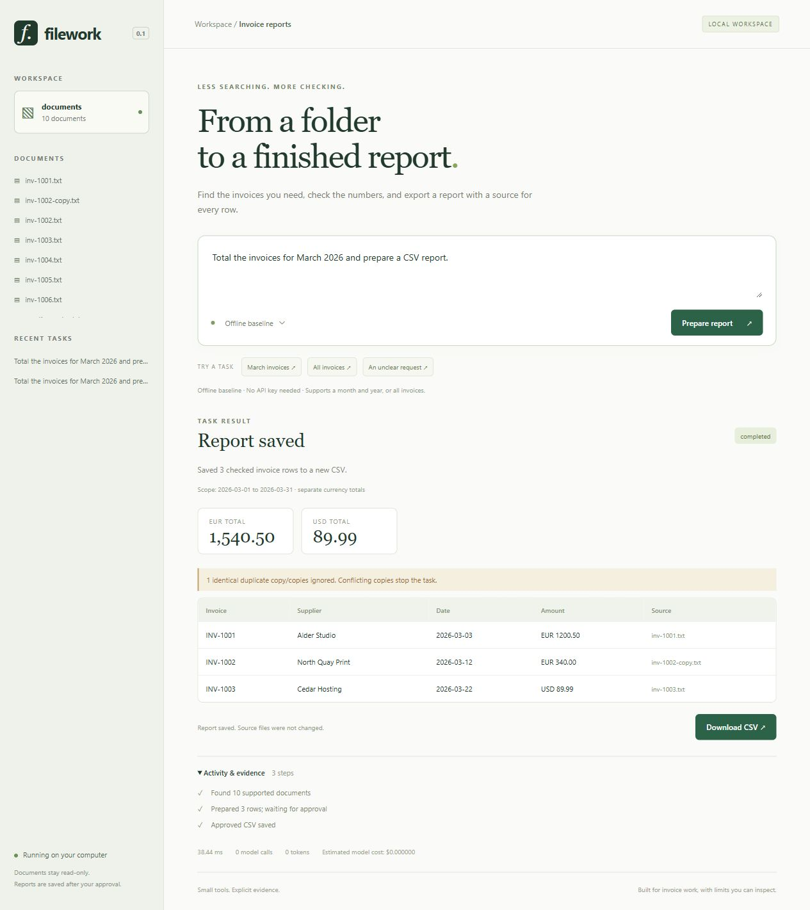
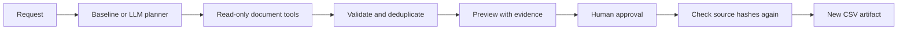

# Filework

A local file assistant that turns invoice requests into checked CSV reports. Every row has a source filename and a SHA-256 hash. Reports stay in preview until approved.



## Try it

Python 3.11 or newer. From the repository root:

```powershell
py -3.12 -m venv .venv
.\.venv\Scripts\Activate.ps1
python -m pip install -e ".[dev]"
filework serve
```

Open **http://127.0.0.1:8765**. On macOS/Linux, create the environment with `python3 -m venv .venv` and activate it with `source .venv/bin/activate`.

The repository includes ten fictional documents. No API key is needed for the offline baseline.

**Current scope:** this is a prototype for explicitly labelled invoices, not a general invoice reader. An independent check on four genuine publicly released billing documents extracted **0/4** complete records. Missing/redacted fields, unfamiliar layouts and scanned pages require manual review. See the [public-document audit](results/public-documents/README.md).

Try:

- `Total the invoices for March 2026 and prepare a CSV report.`
- `Create a report of all invoices.`
- `Find invoices for March.` — asks for a year instead of assuming one.

The March demo should return **EUR 1,540.50** and **USD 89.99**, with three unique invoices and one duplicate copy ignored. Saving creates a new file; it does not modify the documents.

## Two modes

| | Offline baseline | LLM agent |
|---|---|---|
| Request interpretation | Explicit month/year or all invoices | Tool-calling model |
| Additional filters | Asks for clarification | Supplier, date range and currency through tools |
| Model service | None | Your configured provider |
| Extraction and arithmetic | Validated tools | The same validated tools |
| Export | Separate approval | Separate approval |

The baseline is a rules-based comparison, not an AI model. The LLM decides which tools to call and with which filters; it cannot supply arbitrary invoice rows or amounts to the report writer. The tools reread the documents, validate fields, deduplicate records and calculate totals with `Decimal`.

### Enable LLM mode

Use a provider that implements the Chat Completions API with function/tool calling. Set the endpoint, credentials and a model you have access to **in the server's shell**, then restart the server:

```powershell
$env:FILEWORK_API_BASE = "https://api.openai.com/v1"
$env:FILEWORK_API_KEY = "your-key"
$env:FILEWORK_MODEL = "your-tool-calling-model"
filework serve
```

The `.env.example` file documents settings; it is not loaded automatically. A compatible local model server can use an HTTP loopback endpoint and omit the key. Provider support varies; this adapter sends `tools` and `max_completion_tokens` and requires standard tool-call response messages.

Document text passed to `read_document` is sent to the model provider in this mode. Keys are read from environment variables and never returned to the browser or stored in task records. Requests have a 45-second timeout; a task stops after at most ten model turns and six calls per turn.

Token usage is recorded. To estimate cost, set `FILEWORK_INPUT_PRICE` and `FILEWORK_OUTPUT_PRICE` to your provider's USD prices per million tokens. Without these, cost is shown as unknown. No current pricing is assumed.

## Your own documents

Point `FILEWORK_WORKSPACE` at a folder before starting the server:

```powershell
$env:FILEWORK_WORKSPACE = "C:\path\to\invoices"
filework serve
```

Supported: UTF-8 TXT/Markdown and text-based PDFs, up to 2 MB per file, 20 pages per PDF and 250 supported files per workspace. This first version expects one invoice per file and explicit labels:

```text
Invoice ID: INV-1001
Supplier: Alder Studio
Date: 2026-03-03
Currency: EUR
Total: 1,200.50
```

It also recognises `Invoice Number`, `Invoice No.`, `Invoice #`, `Invoice Date` and `Grand Total`. Dates must use ISO format. Totals use decimal points and optional thousands commas. Ambiguous amounts and repeated fields are rejected; scanned PDFs need OCR and are reported as unreadable. The parser does not infer missing totals from line items.

## Evaluation

```powershell
pytest -q
python -m evaluation.run --mode baseline --output results/baseline
```

The recorded offline run passes **80/80 controlled cases** across month/year filtering, all-invoice reports, duplicates, mixed currencies, malformed records, unclear requests, unsupported actions, misleading document instructions and conflicting invoice copies. See [results and limitations](results/baseline/README.md) and [per-case checks](results/baseline/cases.json).

Report cases check the actual CSV fields, totals by currency, source hashes, warnings and duplicate handling. Clarification cases check that no report is prepared or written. Unit/integration tests separately exercise text PDFs, path restrictions, approval, persistence, CSV formula escaping and scripted model-tool responses.

**These are generated text fixtures with repeated layouts, not a real-world accuracy estimate.** The injection cases demonstrate the tool boundary in the offline baseline; they do not prove that an LLM is immune to prompt injection. No live model benchmark is included. The adapter's tool loop is tested with scripted responses, not paid API calls.

The separate [public-document audit](results/public-documents/README.md) uses unchanged pages from government disclosures plus two clearly identified publisher samples. It includes failures and distinguishes extraction coverage from correctly asking for manual review. Reproduce it with `python -m evaluation.public_audit`; this downloads public third-party PDFs into `.runtime/` and does not redistribute them.

Run a separate model evaluation after configuring a provider:

```powershell
python -m evaluation.run --mode llm --output results/llm
```

This makes real API calls and can incur charges. Record the model name, provider, prices and run date when comparing results. Use new held-out layouts and manually reviewed real documents before claiming broader reliability.

## How it works



```text
src/filework/
    agent.py          bounded model-tool loop and offline mode
    documents.py      workspace boundary and invoice parsing
    tools.py          filtering, duplicate checks, totals and export
    planning.py       small offline request interpreter
    server.py         local API, task history and approval
    static/           browser interface, no build step
evaluation/           cases and artifact-based grading
tests/                unit and API integration tests
demo/documents/       fictional data only
results/baseline/     recorded offline benchmark
```

## Boundaries and limitations

- The server binds to loopback. It has no user authentication and is intended for a trusted local machine, not public hosting. Host and origin checks are additional guards, not an authentication system.
- No shell, email, deletion or network tools are available to the model. Source folders cannot be chosen by a browser request. Symlinks and paths outside the configured workspace are rejected.
- Identical copies of the same supplier/invoice number are counted once. Different amounts, dates or currencies for that identity stop the report for clarification. Mixed currencies are never summed together or converted.
- Malformed documents produce visible warnings. A saved report can therefore be incomplete; a person must inspect those warnings. Files without an invoice identifier are treated as non-invoices.
- Before saving, the workspace filenames and hashes must still match the preview. This detects ordinary edits between preview and approval, but is not a filesystem sandbox against a hostile local process racing file operations.
- CSV text fields are escaped when they could be interpreted as spreadsheet formulas.
- Task previews and traces are persisted locally in `.runtime/tasks.db`; approved reports go in `.runtime/reports/`. Keep this folder private when using real records. State is not encrypted at rest and is excluded from Git.
- Tasks run synchronously, one at a time. There is no background queue, OCR, fuzzy deduplication, arbitrary document Q&A or production deployment support.
- The LLM can still misunderstand a request or choose the wrong filters. Evidence checks validate source data and arithmetic, not the semantic correctness of every request interpretation. Review the preview before approval.

## Next steps

Evaluate different invoice layouts, add a labelled held-out PDF collection, compare a baseline with a configured model, and measure errors rather than only successful demos.

## License

MIT. Demo documents are fictional and included for testing.
